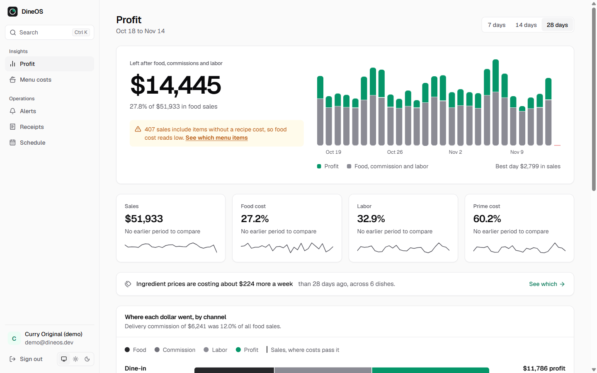
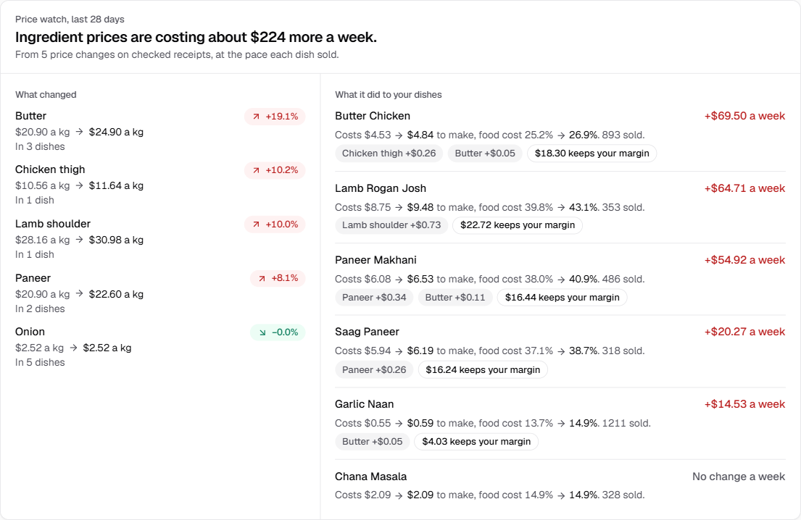
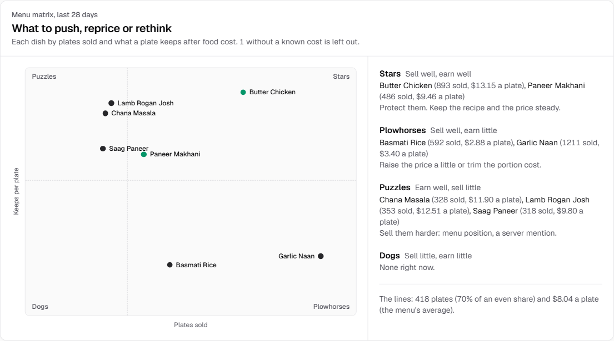
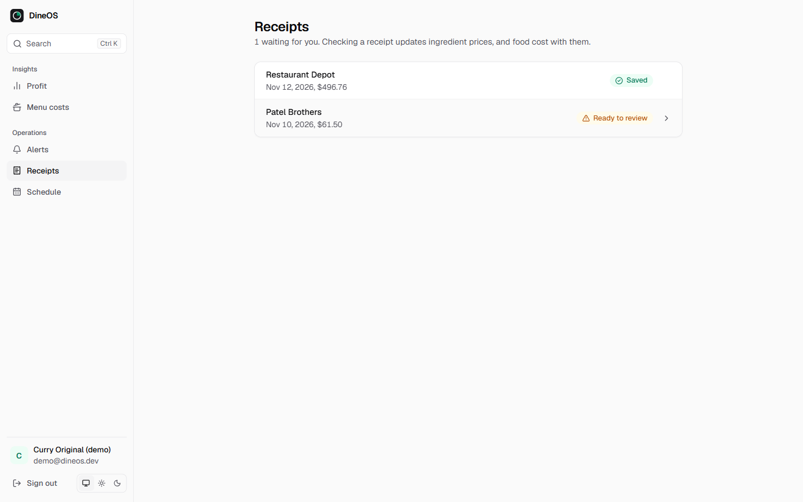
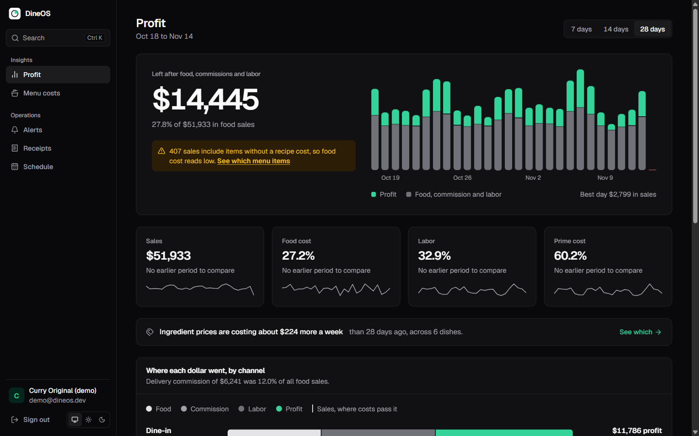
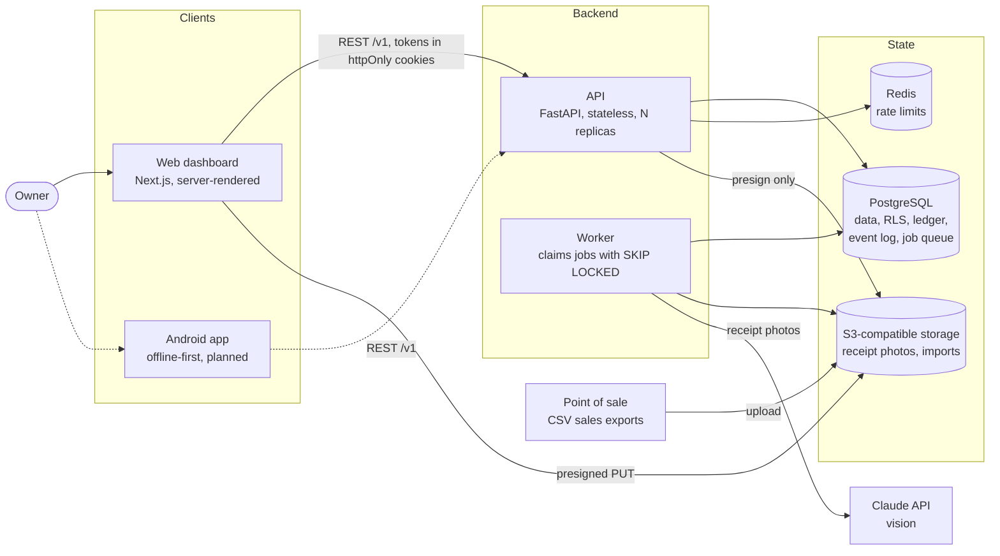
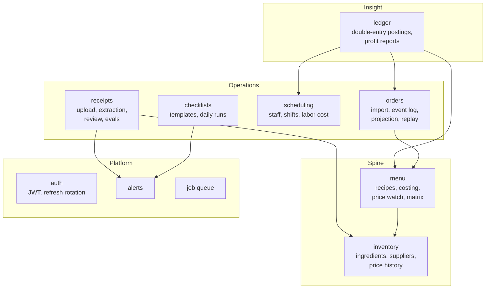
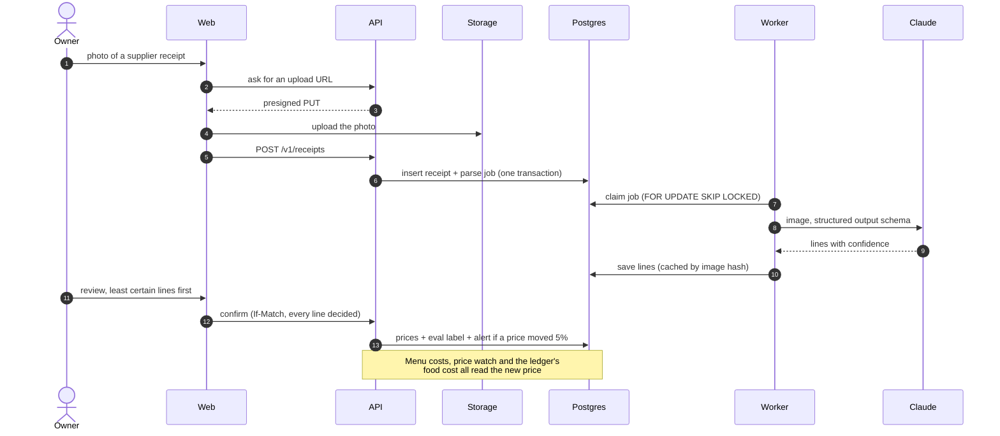
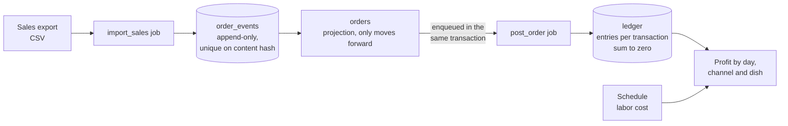

# DineOS

**An operations and profit platform for an independent restaurant.** It answers the question a restaurant owner actually has at the end of the week: *after food, delivery commissions and labor, what did I keep, and what should I change?*

Built for [Curry Original](#who-it-is-for), a family-run Indian restaurant, and written as a production-style system: multi-tenant by row-level security, double-entry books, idempotent ingestion, and a human-in-the-loop AI pipeline with its own evaluation harness.



> Every number in these screenshots is seeded sample data, not real restaurant figures.

## Contents

- [What it does](#what-it-does)
- [Architecture](#architecture)
- [How the data flows](#how-the-data-flows)
- [Engineering decisions worth reading](#engineering-decisions-worth-reading)
- [Run it locally](#run-it-locally)
- [Tests and quality gates](#tests-and-quality-gates)
- [Repository layout](#repository-layout)
- [Status](#status)

## What it does

| | |
|---|---|
| **Profit by channel and dish** | Every sale is posted to a double-entry ledger. The dashboard shows what dine-in and each delivery app left after food cost, platform commission and labor, per day, per channel and per dish. |
| **Food cost from real recipes** | Recipes can contain sub-recipes (a gravy inside a curry). Cost is computed over the whole recipe graph from the latest supplier prices. An unknown cost is shown as unknown, never as $0. |
| **Receipts keep prices current** | A photo of a supplier receipt is read by Claude vision. The owner checks the lines the model was unsure about, and confirmed lines become ingredient prices. Every correction is stored as a label for evaluating the model. |
| **Price watch** | When a receipt moves an ingredient's price, DineOS shows which dishes it hit, splits the change exactly by ingredient, and puts a weekly dollar figure on it. |
| **Menu matrix** | Dishes sorted by "does it sell" and "does a plate earn" into stars, plowhorses, puzzles and dogs, with what to do about each. |
| **Scheduling** | A weekly shift grid in the restaurant's timezone. Double-booking a person is impossible: the database refuses it. Labor cost feeds the profit report. |
| **Order inbox** | Sales exports from the point of sale are ingested idempotently into an append-only event log; orders are a projection that can be rebuilt by replay. |
| **Closing checklist** | Recurring daily checklists with offline-safe check-offs and overdue alerts. |

<table>
<tr>
<td width="50%"></td>
<td width="50%"></td>
</tr>
<tr>
<td><b>Price watch.</b> What changed, what it did to each dish, and the price that would keep the margin.</td>
<td><b>Menu matrix.</b> The plot, and the same dishes in words with advice.</td>
</tr>
<tr>
<td></td>
<td></td>
</tr>
<tr>
<td><b>Receipt review.</b> Least certain lines first; nothing is saved until every line is decided.</td>
<td><b>Dark mode</b> is designed, not inverted, and every color pair is contrast-checked in both themes.</td>
</tr>
</table>

## Architecture

A modular monolith with one database. Each box below is one container in `infra/docker-compose.yml`.



**Why this shape**

- **One Postgres does four jobs**: business data, the append-only event log, the job queue and the ledger. A job is enqueued in the same transaction as the change that caused it, so the queue is also the outbox, and there is no second system to keep consistent.
- **The API never touches file bytes.** Clients upload straight to storage with a presigned URL.
- **The web app is a backend-for-frontend.** The Next.js server holds the tokens in httpOnly cookies and calls the API server-side, so browser JavaScript never sees a token.
- **Redis holds only what can be lost** (rate-limit buckets). If it is down, the limiter fails open and the app keeps working.

### Modules

The backend is split into modules that may only call each other through a public `service.py`. The rule is enforced in CI by `import-linter`, so extracting a module into a service later is mechanical.



## How the data flows

### A receipt photo becomes a price, and a price becomes a decision



### A sale becomes a balanced ledger entry



Re-importing the same file is a no-op. A corrected order is a new event: the ledger reverses the old posting and posts the new one, so the books always net to the latest version and nothing is ever edited.

## Engineering decisions worth reading

| Decision | Why | Where |
|---|---|---|
| **Tenant isolation in the database** | Every table has `tenant_id` and a Postgres row-level security policy; the API connects as a non-superuser. One forgotten `WHERE` cannot leak another restaurant's data. A test proves cross-tenant reads return nothing. | `backend/migrations/versions/0001_tenants_inventory.py`, `backend/tests/test_rls.py` |
| **Double-entry, append-only ledger** | A deferred constraint trigger refuses to commit a transaction whose entries don't sum to zero. The app role has no `UPDATE` or `DELETE` on the books; corrections are reversing entries. | `backend/migrations/versions/0012_ledger.py`, `backend/app/ledger/` |
| **Postgres as the job queue** | `SELECT ... FOR UPDATE SKIP LOCKED`, with the handler running in a savepoint inside the claiming transaction. Enqueue is transactional with the state change, so no dual-write problem and one fewer system to run. | `backend/app/jobs.py`, `backend/tests/test_jobs.py` |
| **No double-booked shifts, guaranteed** | An exclusion constraint over a `tstzrange` makes overlapping shifts for one person impossible, even under concurrent edits. The UI explains the conflict; the database enforces it. | `backend/migrations/versions/0008_scheduling.py` |
| **Recipe cycles blocked by a trigger** | A recursive CTE under a per-tenant advisory lock stops A→B→A on every write path, including two concurrent edits that would each pass alone. | `backend/migrations/versions/0003_recipe_cycle_guard.py` |
| **Exact cost attribution** | Recipe cost is linear in ingredient prices, so re-costing with one price changed at a time splits a cost move into shares that add up exactly, through shared sub-recipes too. | `backend/app/menu/costing.py` |
| **Money is never a float** | Exact `Decimal` cents end to end, rounded once at the output boundary, half-even. Cost and margin on screen always add up to the price. | `backend/app/money.py` |
| **Refresh-token rotation with reuse detection** | Short-lived access JWTs plus opaque refresh tokens stored as hashes. Replaying a used refresh token revokes the whole family. | `backend/app/auth/service.py` |
| **HTTP-native concurrency** | `ETag` / `If-Match` on a version column (412 on a stale write, 428 if missing), client-generated UUIDv7 ids for idempotent creates, cursor pagination, RFC 9457 errors. | `backend/app/api.py`, `backend/app/crud.py` |
| **The model is measured, not trusted** | Owner corrections are stored next to the model's output. A CLI harness scores per-field accuracy, cost and latency per model and prompt version, and calibrates the confidence threshold. | `backend/app/receipts/evals.py` |
| **One design-token source, contrast-checked** | Colors live in `design/tokens.json`. The generator refuses to emit CSS if any text or chart pair is below WCAG AA in either theme, and CI fails on drift. | `design/build-tokens.mjs` |
| **Charts without a chart library** | Trend bars, sparklines and the matrix are server-rendered HTML and SVG: no client JavaScript, CSS tooltips that work with the keyboard, and a text equivalent for every figure. | `web/src/app/(app)/daily-chart.tsx` |

## Run it locally

Requires Docker. Everything runs in Compose; the only paid dependency is the Claude API, and it is optional (the demo ships with receipts already parsed).

```bash
# 1. Start the stack: Postgres, Redis, storage, migrations, API, worker, web
DEMO_LOGIN=1 docker compose -f infra/docker-compose.yml up --build -d

# 2. Seed a demo restaurant: four weeks of orders, shifts, recipes, receipts and price changes
docker compose -f infra/docker-compose.yml run --rm migrate python -m app.seed
```

Open <http://localhost:3000>. With `DEMO_LOGIN=1` the sign-in form is prefilled (`demo@dineos.dev`). The API's interactive docs are at <http://localhost:8000/docs>.

Demo dates are relative to the day you seed. To refresh an old demo: `... run --rm migrate python -m app.seed --reset`.

To parse real receipt photos, set `ANTHROPIC_API_KEY` in your environment before `up`. Without it, parse jobs retry with backoff and everything else works.

<details>
<summary><b>Develop without Docker for the app code</b></summary>

```bash
# Infrastructure only
docker compose -f infra/docker-compose.yml up -d postgres redis seaweedfs

# Backend (Python 3.13, uv)
cd backend
cp .env.example .env
uv sync
uv run alembic upgrade head
uv run python -m app.seed
uv run uvicorn app.main:app --port 8001

# Web (Node 20), in a second terminal
cd web
npm ci
API_URL=http://localhost:8001 DEMO_LOGIN=1 npm run dev
```

</details>

## Tests and quality gates

CI (`.github/workflows/ci.yml`) runs four jobs on every pull request:

| Job | What it checks |
|---|---|
| **backend** | `ruff` lint and format, `mypy --strict`, `import-linter` module boundaries, migrations from scratch, `pytest` against a real Postgres and Redis |
| **web** | design tokens regenerate without drift (including the contrast check), ESLint, TypeScript, production build |
| **e2e** | Playwright against a real, seeded API: sign-in, a full receipt review, the schedule refusing an overlap, the command menu, and `axe-core` on every page in light and dark |
| **docker** | both images build |

Tests target the hard parts, not coverage numbers: a two-connection race that must fail when the shift constraint is removed, a ledger transaction that must not commit unbalanced, cross-tenant reads that must return nothing, and hand-derived expected values for every cost calculation. The Claude API is never called in tests or CI.

```bash
cd backend && uv run pytest            # needs the Compose Postgres and Redis
cd web && npx playwright test          # needs a seeded API and the web server
```

## Repository layout

```
backend/     FastAPI app: one folder per module (models, schemas, service, router)
  app/         menu, inventory, orders, receipts, scheduling, checklists, ledger, alerts, auth
  migrations/  hand-written SQL migrations (RLS policies, triggers, constraints)
  tests/       pytest, real Postgres
web/         Next.js dashboard (App Router, server components, typed client from OpenAPI)
  e2e/         Playwright + axe-core
design/      tokens.json, the token generator, wireframes, screenshots
infra/       docker-compose.yml, Postgres role bootstrap
```

## Who it is for

One real user today: the owner of a family-run Indian restaurant, who currently pieces these numbers together from the point of sale, delivery-app statements and paper receipts. The design targets three situations: the owner on the kitchen floor (phone, one hand, interrupted), the owner at night (laptop, dense numbers), and someone opening the demo for thirty seconds.

## Status

**Built:** multi-tenant spine (ingredients, recipes, menu, food cost), auth, job queue, receipt ingestion and review, eval harness, scheduling, closing checklists, rate limiting, structured logs and metrics, order inbox, profitability ledger, and the web dashboard (profit, menu costs with price watch and matrix, receipts, schedule, alerts; light and dark; phone layout).

**Next:** offline-first Android app (Room as the local source of truth, a sync queue, conflict merge), a public demo deployment, and first measured numbers from real receipts.

**Not measured yet:** receipt extraction accuracy and cost per receipt, time saved per week, and API latency under load. They will be reported here when measured on real data, not estimated.

**Deliberately out of scope:** loyalty, online ordering, kitchen display, marketing. Existing point-of-sale products already ship those; this project goes deep on a few hard problems instead.
